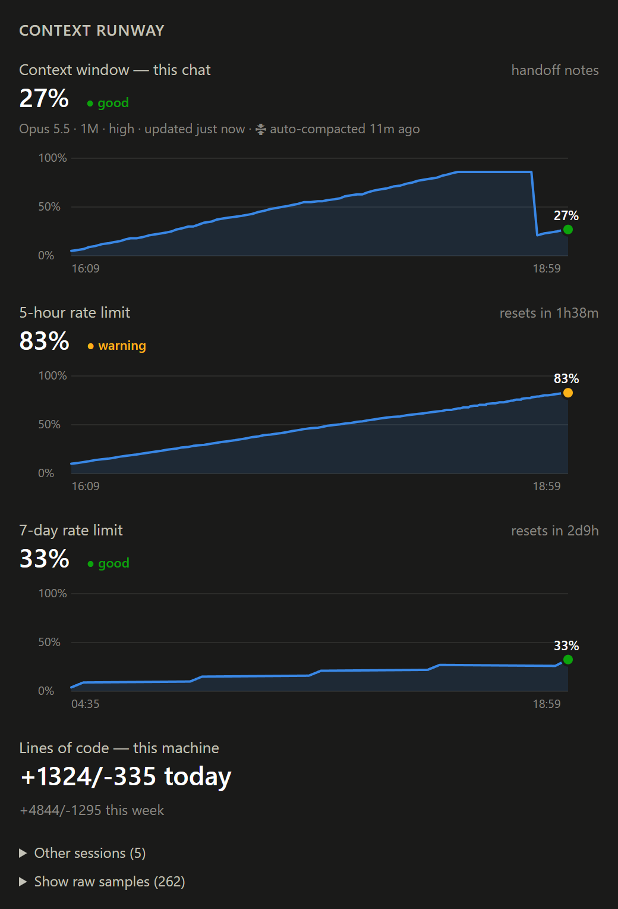

# context-runway

[](https://github.com/garcialuis23/context-runway/actions/workflows/ci.yml)
[](https://github.com/garcialuis23/context-runway/actions/workflows/codeql.yml)
[](LICENSE)

Visual tooling to see how much conversation/context "runway" you have left when working with Claude Code — tokens remaining in the current context window, and how close you are to your account's hourly/weekly usage limits — and to not lose your place when you run out.

## Features

- **Context runway** — how full the current conversation's context window is, and roughly how many turns are left at your current pace.
- **Rate limits** — 5-hour and 7-day account usage, when each resets, and a ⚠ warning if you're on pace to hit 100% before the reset.
- **Lines of code** — lines Claude Code added/removed today and this week, across every session on the machine.
- **Handoff notes** — when context reaches 80% (just before auto-compaction) or the 5-hour limit reaches 95%, Claude saves notes on where the work stands. The next new session in that project starts with them loaded and picks up where you left off. [How it works](statusline/README.md#handoff-notes).
- **History charts** — the VS Code extension shows all of the above over time.

It's made of two pieces:

- [`statusline/`](statusline/) — a Claude Code status line plus the handoff hooks. This is the core; everything else reads what it records.
- [`extension/`](extension/) — an optional companion VS Code extension with a status bar item and a webview panel with history charts, reading the same data the statusline writes.

## Screenshots

The status line, right in the terminal — context left in this chat, 5-hour and 7-day limits (⚠ = on pace to run out before the reset), lines of code, and a recent auto-compaction:


The VS Code panel, with the same data over time:



## Requirements

- Node.js >= 18
- Claude Code (for the statusline)
- VS Code >= 1.85 (for the extension, optional)

> **Note:** the 5-hour/7-day rate-limit charts need at least one **terminal** `claude` session running the statusline. Claude Code's native VS Code extension (the embedded chat panel) doesn't appear to feed rate-limit data to the status line the way a terminal session does — see [`extension/README.md`](extension/README.md#known-limitation-5h7d-needs-a-terminal-claude-code-session). The context-window chart is unaffected.

## Quick start

```bash
git clone https://github.com/garcialuis23/context-runway.git
cd context-runway/statusline
npm run install-statusline
```

This sets up both the status line and the handoff hooks in `~/.claude/settings.json` (backing it up first). Start a new Claude Code session to see it.

Then, for the richer VS Code view:

```bash
cd extension
npm run package
code --install-extension context-runway-0.1.0.vsix
```

See [`statusline/README.md`](statusline/README.md) and [`extension/README.md`](extension/README.md) for details.

## Updating

Neither piece auto-updates, and nothing is synced between machines — usage history and handoff notes stay on the machine that wrote them. If you have this installed on more than one machine, repeat these steps on **each one** after pulling a new version:

```bash
git pull
```

- **statusline**: usually that's it. `~/.claude/settings.json` points straight at the scripts in your clone, so the next Claude Code session picks up code changes automatically. Re-run `npm run install-statusline` only when an update adds a new setting — as the handoff-notes release did (it registers two new hooks), so run it once on each machine after pulling that version:

  ```bash
  cd statusline
  npm run install-statusline
  ```

  Then start a new Claude Code session; sessions that were already open keep their old settings.
- **extension**: the VS Code extension is an installed `.vsix`, not read live from the repo, so a `git pull` alone does nothing for it. Rebuild and reinstall:

  ```bash
  cd extension
  npm run package
  code --install-extension context-runway-*.vsix --force
  ```

## Contributing

Contributions are welcome via pull request — see [CONTRIBUTING.md](CONTRIBUTING.md).
`main` is protected, so all changes (including the maintainer's) go through review.
Found a security issue? See [SECURITY.md](SECURITY.md) instead of opening a public issue.

## License

[MIT](LICENSE)
