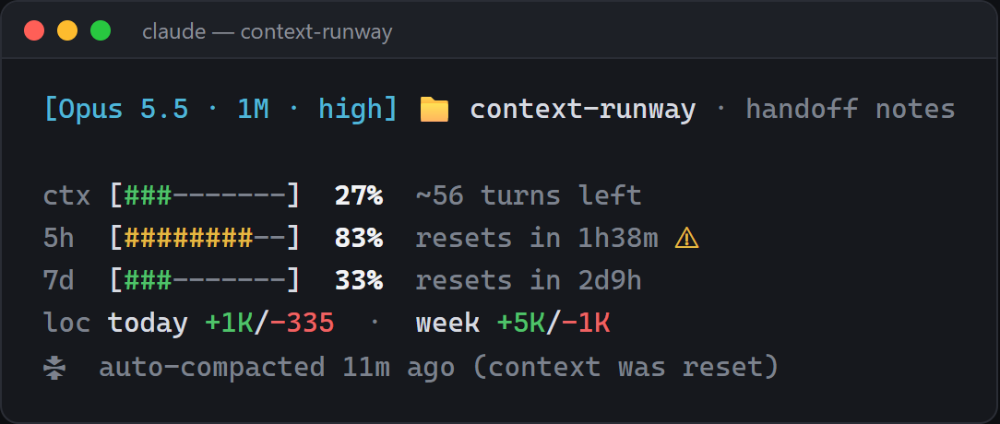

# context-runway statusline

A Claude Code status line that shows, at a glance:

- **Context runway**: how much of the current conversation's context window is used, plus an estimate of how many turns are left at the current burn rate.
- **Rate limits**: how much of your 5-hour and 7-day account usage windows are used, when each resets, and a burn-rate projection warning (⚠) if you're on pace to hit 100% before the window resets.
- **Lines of code**: how many lines Claude Code has added/removed today and in the last 7 days, across every session on this machine. This is per-machine only — it's built from the local `usage-history.jsonl` log, not synced across machines or accounts.
- **Handoff notes**: when the conversation's context window reaches 80% or your 5-hour limit reaches 95%, Claude saves notes on where the work stands, and the next new session in that project starts with them loaded. See [Handoff notes](#handoff-notes).

The status line reads the JSON Claude Code already sends to status line scripts (`context_window`, `rate_limits`) — no scraping, no extra API calls, no added token cost. The only token cost is the handoff notes themselves: Claude writing them once near a limit, and reading them at the start of the next session.



Requires Node.js >= 18.

## Install

```bash
git clone https://github.com/garcialuis23/context-runway.git
cd context-runway/statusline
npm run install-statusline
```

This merges a `statusLine` entry and the two handoff hooks (`UserPromptSubmit`, `SessionStart`) into `~/.claude/settings.json` (backing up the previous file to `settings.json.context-runway-backup` first) and leaves every other setting untouched. Restart Claude Code, or start a new session, to see it.

To remove it:

```bash
npm run uninstall-statusline
```

## Handoff notes

Running out of context or hitting the 5-hour limit used to mean re-explaining everything in the next chat. Now, near either limit, Claude writes down where things stand, and the next session reads it back.

**When notes are written.** On each message you send, a hook checks the latest usage the status line recorded:

| Limit | Threshold | Asked again |
| --- | --- | --- |
| Context window (this conversation) | 80% | Only after usage drops back, e.g. after a compaction |
| 5-hour limit (whole account) | 95% | Once per 5-hour window |

The first time a limit crosses its threshold, Claude is asked to save notes as part of its reply, with these sections: **Goal**, **Done**, **In progress**, **Next steps**, **Key files** and **Open questions**. It mentions in the reply that it saved them. The context threshold is 80% rather than 95% because Claude Code auto-compacts at around 85%, and usage data lags one message behind.

**When notes are read.** When you start a new session in the same project (or run `/clear`, or the conversation gets compacted), the notes are loaded into it automatically, so you can just say "carry on". Each version of the notes is loaded once, so later sessions aren't flooded with stale context, and notes older than 7 days are ignored. Resuming an existing conversation (`claude --resume`) skips them, since that conversation is already there.

**Where they live.** `~/.claude/context-runway/handoffs/<project>-<hash>.md`, one file per project folder, overwritten each time. They're plain Markdown: open them to see what was saved, edit them, or delete them to start fresh. They're kept outside your project so they never end up in a commit, and they stay on the machine that wrote them.

The first time Claude writes notes it may ask permission to write to that folder, since it's outside your project.

## Updating

`~/.claude/settings.json` points straight at the scripts inside this clone, so a plain `git pull` is usually enough to pick up a new version — no need to re-run the installer. The exceptions: `npm install` if `package.json` changed, or `npm run install-statusline` again if the update added a new setting. **The handoff-notes release did** (two new hooks), so run the installer once after pulling it, then start a new Claude Code session. If you have this installed on multiple machines, none of this syncs automatically — repeat on each one.

## How it works

- `src/index.js` is the entry point Claude Code invokes on stdin/stdout after each assistant message.
- `src/lib/history.js` persists a throttled, rolling log of usage snapshots to `~/.claude/context-runway/usage-history.jsonl` (pruned to 9 days), so trends can be computed across turns and sessions.
- `src/lib/projection.js` fits a simple slope to recent samples within the current rate-limit window and projects whether you'll exhaust it before it resets.
- `src/lib/linesOfCode.js` turns Claude Code's cumulative-per-session `cost.total_lines_added`/`total_lines_removed` counters into a today/this-week total across every session in the log, by diffing consecutive same-session snapshots rather than summing raw totals (which would double count).
- `src/lib/render.js` renders the progress bars, colors (green/yellow/red at 70%/90% thresholds), durations, and the lines-of-code row.
- `src/handoff.js` runs as two Claude Code hooks and only reads the usage log the status line writes:
  - On each prompt (`UserPromptSubmit`) it checks this session's context usage and the account's 5-hour usage. The first time either crosses its threshold, it adds a note asking Claude to write handoff notes to `~/.claude/context-runway/handoffs/<project>-<hash>.md`. It asks once per crossing: for context, again only after usage drops back (a compaction); for the 5-hour limit, once per window.
  - On a new, cleared or compacted session (`SessionStart`, not resumes) it loads that project's notes into the session, once per version of the file, ignoring notes older than 7 days. Notes live outside your project, so they never end up in a commit.
  - Usage data comes from the status line, so it reflects the last assistant message — that's why the context threshold sits well below the ~85% where auto-compaction kicks in.

## Try it without installing

```bash
npm run demo
```

Pipes `test/fixture.json` (a mock payload matching Claude Code's documented schema) through the script so you can see the output format.

## Tests

```bash
npm test
```

Runs the automated suite (`node --test`) covering `src/lib/*`, `src/index.js`, `src/handoff.js` and the installer's hook merging, including edge cases like malformed input, throttling, pruning, compaction detection, and rate-limit projections. Every test that touches the filesystem points `CONTEXT_RUNWAY_STATE_DIR` at a throwaway temp directory, so it never reads or writes your real `~/.claude/context-runway/usage-history.jsonl`.

## Contributing

See the [root CONTRIBUTING.md](../CONTRIBUTING.md) — PRs welcome, `main` is protected.
Found a security issue? See [SECURITY.md](../SECURITY.md) instead of opening a public issue.
